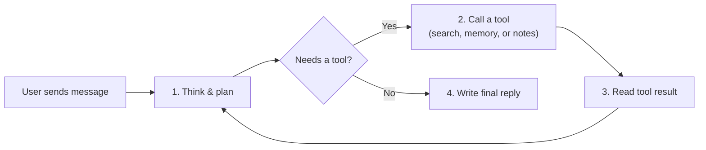

# AI Agents: How Agentic Chatbots Work

Data Foundry lets you build two kinds of custom chatbots: **Standard** and **Agentic**.

A standard chatbot works like a quick question-and-answer machine. You send a message, it grabs a few matching lines from your documents, and it replies right away.

An **agentic chatbot** can plan and take actions before it replies. This page explains the key ideas behind agentic chatbots in plain terms.

If you prefer to learn by building one first, try the beginner tutorial **[Building Your First Agentic Chatbot]()** or the full **[Diary Study Companion tutorial]()**.

---

## 1. What is an AI agent?

Think of a normal chatbot as a colleague answering from memory at a coffee machine. They give an immediate reply, even if they are not sure.

An **AI agent** is more like a librarian at a desk. When you ask a question, the librarian first decides what to do:
- If it is a simple "hello", they answer right away.
- If you ask about a rule in a handbook, they walk to the shelf, find the right page, read it, and then answer you.
- If you tell them something important about your project, they write it down in your folder for next time.

In short, an agent is an AI model that can **choose to use tools** instead of only writing text.

---

## 2. Tools

A **tool** is a small action that the platform gives to the AI model. The model cannot run code on your computer or browse the web on its own. It can only ask Data Foundry to run one of its built-in tools.

Depending on your bot's settings and uploaded documents, an agentic chatbot has access to these tools:

| Tool | What it does | When it is available |
| :--- | :--- | :--- |
| `search_knowledge_base` | Searches the reference documents you uploaded to the bot. | When at least one document is uploaded. |
| `update_user_memory` | Saves or updates a short fact about the current user (for example, `bike_type`). | When **User Memory & Notes** is enabled. |
| `delete_user_memory` | Removes one saved fact when the user asks. | When **User Memory & Notes** is enabled. |
| `write_user_file` | Creates or overwrites a flat Markdown note file (for example, `notes.md` or `diary.md`) for the current user. Subfolders and non-`.md` files are not allowed. | When **User Memory & Notes** is enabled. |
| `read_user_file` | Reads one of the current user's saved note files. | When **User Memory & Notes** is enabled. |
| `delete_user_file` | Deletes one of the current user's note files. | When **User Memory & Notes** is enabled. |
| `reset_user_memory` | Clears all saved facts and note files for the current user. | When **User Memory & Notes** is enabled. |

{: .info}
You do **not** need to list or explain these tool names in your system prompt. Data Foundry automatically adds a short technical description of the active tools when the agent starts. Use `AGENTS.md` to tell the bot *when* and *how* you want it to use them.

---

## 3. The Think-and-Act loop

A standard chatbot runs one step per message: *prompt in → answer out*.

An agentic chatbot runs a **Think-and-Act loop** (sometimes called *ReAct* in research papers). For each user message, the model goes through one or more cycles:

1. **Think and plan:** The model reads your message, the conversation so far, and the user's saved facts. It decides whether it needs more information or needs to save something.
2. **Call a tool (optional):** If needed, it asks Data Foundry to run a tool—for example, `read_user_file("diary.md")` followed by `write_user_file("diary.md", ...)`.
3. **Read the result:** Data Foundry runs the tool and hands the result back to the model.
4. **Repeat or reply:** The model thinks again. It can call another tool if needed, or write its final answer to the user.

### The 10-step safety limit

To stop an agent from getting stuck in an endless loop, Data Foundry limits every message to at most **10 steps** (iterations). After 10 tool-and-think cycles, the agent stops and returns what it has.

---

## 4. Three kinds of "memory"

Beginners often mix up the three ways a chatbot keeps information. They serve completely different purposes:

| Type of information | What it holds | Who sees it | How long it lasts |
| :--- | :--- | :--- | :--- |
| **Conversation history** | The messages in the current chat thread. | Only the user in that chat (and the designer if transcripts are saved). | Only in that chat thread. Lost when you start a new chat. |
| **User memory & notes** | Short profile facts (`update_user_memory`) and private `.md` files (`diary.md`, `notes.md`). | Only that one user, plus the bot designer (see Section 7). | Across all chat threads for that bot, until deleted. |
| **Knowledge base** | Reference documents (`.pdf`, `.md`, `.txt`) uploaded by the designer. | Shared (read-only) for every user of the bot. | Until the designer deletes the document. |

A helpful rule of thumb:
- Put **shared study rules and guides** in the **Knowledge Base**.
- Store **personal facts and logs per user** in **User Memory & Notes**.
- Leave **back-and-forth clarifications** in the **Conversation History**.

---

## 5. Knowledge base search (retrieval)

When you upload a PDF, Markdown, or text file under **📚 Knowledge Base**, Data Foundry does not paste the whole file into every prompt. Instead:

1. **Splitting into chunks:** Data Foundry breaks the document into small sections (**chunks**). For Markdown files, it splits at headings (`#`, `##`, `###`, `####`).
2. **Indexing:** Each chunk is turned into a searchable entry. Once ready, the file shows **Indexed ✅**.
3. **On-demand search:** When the agent calls `search_knowledge_base`, Data Foundry returns up to **Max Reference Chunks** matching pieces that score above the **Relevance Threshold**.
4. **Citations:** When the bot uses a chunk, the chat shows a clickable tag such as `[1] study_protocol.md (85%)`. Clicking it opens the exact quoted passage.

{: .info}
**Writing tip for designers:** Write your knowledge base files in Markdown and put **one clear topic under each `##` heading**. Short, focused sections make search results much more accurate than one long wall of text.

---

## 6. System prompt vs. `AGENTS.md`

In Agentic mode, you configure text in two places:

- **Instructions (System Prompt):** Defines *who* the bot is—its role, tone, and baseline context. You can include `$DATE` here so Data Foundry inserts today's date.
- **`AGENTS.md`:** The bot's *working rules*—when to save memory, what file name to use for notes, when to search the knowledge base, and what the bot must never do.

Keeping identity (System Prompt) separate from rules (`AGENTS.md`) makes it much easier to test and adjust your bot's behavior without rewriting its whole personality. You can find tips on writing prompts in [Prompting]().

---

## 7. Privacy and who can see what

Understanding who can read what is critical if you use a chatbot with research participants:

- **Participant-to-participant isolation:** Every user has their own separate memory folder. User A cannot read, edit, or ask the bot about User B's facts, notes, or chat threads.
- **Designer visibility:** As the bot's editor, **you can view each user's saved facts and note files** using the **Viewing User Memory:** dropdown in **Test Bot**, and you can read saved conversations under **💬 Conversations** when **Save chat transcripts** is on.
- **User control:** Users chatting with the bot can click **🧠 Memory** in the chat toolbar to inspect, delete individual items, or clear all their saved facts and notes.

{: .warning}
**Transparency in user studies:** Because you as the researcher can read saved memory, notes, and transcripts, always inform participants clearly in your consent form and study protocol. Follow your institution's [data protection guidelines]() and [project review process]() before collecting real participant data.

---

## 8. How users connect: identities and memory

Data Foundry supports four ways for people or apps to talk to your chatbot. Persistent user memory only works when Data Foundry knows *who* the user is:

| How the user connects | Conversation history | User memory & notes | Notes |
| :--- | :---: | :---: | :--- |
| **Web chat (logged-in Data Foundry account)** | Yes | **Yes** | Standard way to share a **Public (Shared)** bot with students or colleagues. |
| **Chatbot API with Project/User API Key or Dataset Token + `user` field** | Yes (via `conversationId`) | **Yes** | For custom web apps or prototypes. Keep API keys and dataset tokens on a server, never in browser code. |
| **Chatbot API with a Study Participation Token** | Yes | **No** | Participation tokens are not supported for user memory yet (and cannot override `user`). |
| **Chatbot API with a Dataset API Token (no `user` field)** | Yes | **No** | Without a `user` field, the token has no individual user identity, so memory is disabled. |

See the **[Chatbot API Reference]()** for request examples.

---

## 9. Limits and safety

Agentic chatbots are powerful, but they have real limits you must design around:

- **Fixed model:** In Agentic mode, Data Foundry selects its tool-calling coding model automatically, so you do not pick a model or temperature yourself. (Read [Model Categories]() to learn how model sizes differ in general.)
- **Rules are guidance, not guarantees:** The AI reads `AGENTS.md` as strong instructions, not strict computer code. A model can sometimes forget to call a tool, ask two questions instead of one, or phrase a note slightly differently. Always **test and refine** your rules.
- **Slower and higher token use:** Because the bot may think and call tools several times before answering, each reply takes longer and spends more project tokens than a standard chatbot.
- **Prompt injection and untrusted text:** Never assume a user—or text inside a document—cannot try to trick the bot into ignoring its rules. Data Foundry marks retrieved documents and user memory as untrusted data so the model ignores hidden commands inside them, but you should still **never put passwords, API keys, or private secrets** inside `AGENTS.md` or your system prompt.

---

## 10. Agentic or Standard? A quick checklist

Choose **Agentic mode** if you answer **yes** to at least one of these:
1. Does the bot need to remember facts about each user from one day to the next?
2. Does the bot need to write or update structured notes (like a diary, plan, or log)?
3. Should the bot search documents *only* on certain questions instead of every message?
4. Do you want users to keep several separate chat threads while sharing the same memory?
5. Do you need clear step-by-step workflow rules (`AGENTS.md`)?

**When NOT to use Agentic mode:** If you are building a simple FAQ bot, a one-shot quiz helper, or a prototype where fast replies and low token cost matter most, use **Standard mode**—or **[ConvoScript]()** if you want strictly scripted steps that always follow an exact order.

---

## Glossary

- **Agent:** An AI model that can decide to call tools in a loop before giving a final answer.
- **Chunk:** A short piece of an uploaded document used during search.
- **Citation:** A clickable reference tag showing which document chunk an answer came from.
- **Conversation history:** The back-and-forth messages inside one chat thread.
- **Knowledge base:** The reference documents you upload to a chatbot for shared lookup.
- **Model:** The underlying AI system (large language model) that reads prompts and generates text or tool calls.
- **Step (iteration):** One cycle of thinking and calling a tool inside the Think-and-Act loop (maximum 10 per message).
- **System prompt:** The main instructions defining the bot's identity, role, and tone.
- **Temperature:** A setting (used in Standard mode) that controls how predictable vs. varied replies are.
- **Token:** A small piece of text (roughly three-quarters of a word) used to measure AI usage and project limits.
- **Tool / Tool call:** A built-in action (like searching documents or saving a note) that the agent asks Data Foundry to run.
- **User memory:** Saved facts and private Markdown files stored separately for each user.
